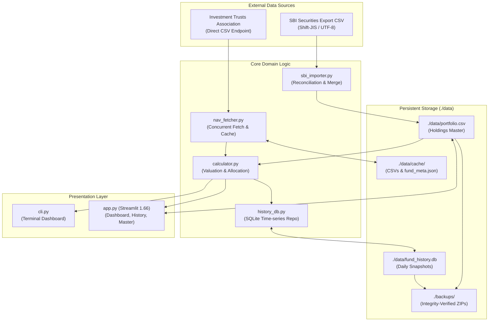
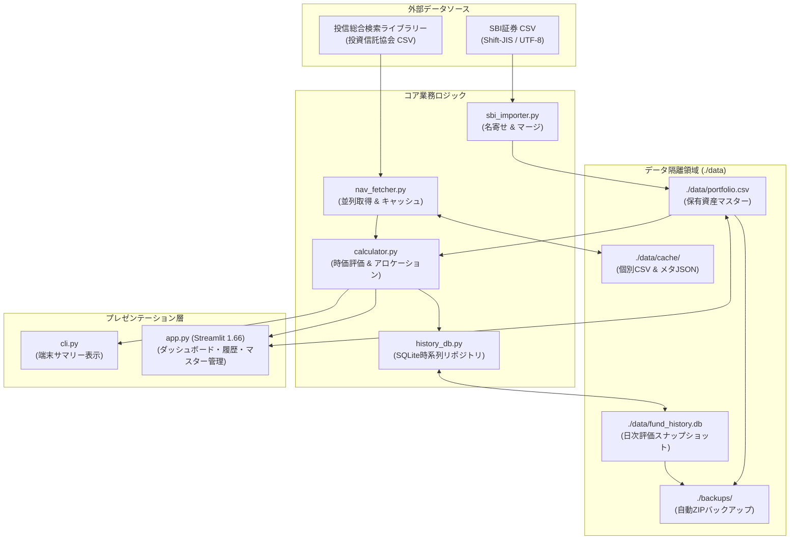

# 投資信託 ポートフォリオ評価システム (Fund Manager)

[English](#english) | [日本語](#japanese)

---

<a name="english"></a>
## English

### Overview
**Fund Manager** is an investment trust portfolio management utility. It directly fetches official Net Asset Value (NAV / 基準価額) time-series data from The Investment Trusts Association, Japan (投資信託協会「投信総合検索ライブラリー」), reconciles it against locally stored holdings (`portfolio.csv`), and evaluates valuation, unrealized gain/loss, and asset allocation across accounts (Corporate, NISA, Taxable, iDeCo/DC).

### Architecture & Key Features
- **Direct Association API & Fault-Tolerant Cache**: Downloads daily NAV CSVs directly from official endpoints concurrently with automatic fallback to local cache (`./data/cache/`) and embedded dictionary values during network outages.
- **SBI Securities CSV Direct Import & Smart Reconciliation**: Parses SBI Securities portfolio export CSV files (Shift-JIS/CP932/UTF-8) with automatic 8-digit association code and ISIN lookup, custom alias learning (`./data/custom_fund_aliases.json`), and atomic merge modes (UPSERT, Replace, or Append).
- **Master Asset Management & Streamlit 1.66 Integration**: Interactive asset editing and immediate re-calculation via `st.data_editor` with atomic file persistence (`save_portfolio_csv`) and dedicated theme padding configuration (`.streamlit/config.toml`).
- **Account (Tank) Allocation & Visual Analytics**: Instant allocation breakdown by account and fund category with Altair donut charts, stacked area charts, and CLI ASCII progress bars.
- **Historical Time-Series SQLite Persistence**: Automatically stores daily evaluation snapshots into `./data/fund_history.db` for multi-period trend analysis (1M, 3M, 6M, 1Y, 3Y, All).
- **Strict Data Isolation & Integrity Backups**: Strict isolation of all dynamic states within `./data`, combined with automated ZIP packaging and `testzip()` cyclic redundancy verification via `backup_manager.py`.

### System Architecture


### Directory Structure
```
Fund_Manager/
├── .streamlit/
│   └── config.toml         # Streamlit 1.66 UI theme & padding configuration
├── data/                   # Persistent Data Isolated Directory (Git ignored)
│   ├── cache/              # Cached Toushin Kyokai CSVs & fund_meta.json
│   ├── portfolio.csv       # User portfolio holdings master
│   ├── fund_history.db     # SQLite snapshot historical database
│   └── custom_fund_aliases.json # Learned fund alias mapping
├── src/
│   ├── models.py           # Pydantic schemas & frozen dataclasses
│   ├── portfolio_loader.py # portfolio.csv loader & presets
│   ├── nav_fetcher.py      # Toushin Kyokai direct API client
│   ├── calculator.py       # Portfolio valuation & KPI aggregation
│   ├── sbi_importer.py     # SBI Securities CSV parser & wizard
│   ├── history_db.py       # SQLite repository for time-series snapshots
│   ├── formatter.py        # Currency & rate formatting utilities
│   └── ui/                 # Streamlit UI zone modules
│       ├── header.py       # Header zone
│       ├── sidebar.py      # Sidebar zone (force refresh, backup, upload)
│       ├── tab_dashboard.py# Portfolio dashboard & KPI metrics
│       ├── tab_history.py  # Fund historical performance analysis
│       ├── tab_master.py   # Portfolio master management (data editor)
│       └── sbi_wizard.py   # Interactive SBI import wizard
├── tests/                  # Unit and integration test suite
├── app.py                  # Streamlit application orchestration
├── cli.py                  # CLI evaluation and batch import runner
├── backup_manager.py       # Backup automation & integrity testing
├── run.bat                 # Windows one-click launcher
├── run.command             # macOS/Linux one-click launcher
└── pyproject.toml          # Project metadata & dependencies (uv)
```

### Setup & Execution
#### Using `uv` (Recommended)
```bash
# 1. Install dependencies
uv sync

# 2. Run CLI Dashboard
uv run python cli.py

# 3. Launch Streamlit Web GUI
uv run streamlit run app.py
```

#### One-Click Launchers
- **Windows**: Double-click `run.bat` (automatically installs `uv` and dependencies if absent).
- **macOS / Linux**: Execute `./run.command`.

### Environment Variables
| Variable | Default Value | Description |
| :--- | :--- | :--- |
| `BACKUP_DIR` | `./backups` | Target directory path for data backup ZIP archives |

### Limits & Known Trade-offs
- **NAV Update Timing**: Official NAV data from the Investment Trusts Association is published once daily on business days between 19:00 and 21:30 JST. Re-fetching data during daytime trading hours returns the latest available business day's valuation date.
- **Supported Assets**: Designed specifically for mutual funds matching Japan 8-digit association codes and 12-digit ISIN codes. Individual stocks, ETFs, and cryptocurrencies are not directly evaluated.

---

<a name="japanese"></a>
## 日本語

### 概要
**Fund Manager** は、投資信託協会の「投信総合検索ライブラリー」直結エンドポイントから最新の基準価額時系列データを自動取得・解析し、ローカルに保持する保有資産（`portfolio.csv`）と突き合わせて口座（法人、NISA成長/つみたて枠、特定、iDeCo、DCなど）ごとの時価評価額・評価損益・アセットアロケーションを算出・可視化する資産管理システムです。

### アーキテクチャと主要機能
- **投信総合検索ライブラリー直結CSV自動取得 & 耐障害キャッシュ**: 投資信託協会の全銘柄共通直結エンドポイント（Shift-JIS）より対象銘柄の最新基準価額を並列取得。個別CSV/JSONメタキャッシュ（`./data/cache/`）および内蔵フォールバック辞書により、オフライン時や回線切断時も安全に稼働。
- **SBI証券ポートフォリオCSV直接インポート & 名寄せ学習**: SBI証券からダウンロードした保有証券CSV（Shift-JIS/CP932/UTF-8）の階層構造を自動パース。ファンド名から協会コード（8桁）・ISINを逆引き補完し、未知の銘柄も手動マッピング（`./data/custom_fund_aliases.json`）として自動学習。事前バックアップ連動のマージ（UPSERT / 全置換 / 新規追加）に対応。
- **保有資産マスター管理 & Streamlit 1.66 対応**: Streamlit 1.66 系の最新UI設計（`.streamlit/config.toml` による余白最適化、タブ分割）および `st.data_editor` による対話的編集・原子的ファイル保存（`save_portfolio_csv`）を提供。
- **口座（タンク）別アロケーション評価**: 法人・NISA・特定・確定拠出年金などの保管口座ごとの時価評価額、構成比率、含み損益をAltairドーナツチャートおよびCLIプログレスバーで即時可視化。
- **時系列履歴データベース永続化 (SQLite) & 推移分析**: `./data/fund_history.db` への日次スナップショット自動記録、全資産積み上げ面グラフ、およびファンド別推移分析タブ（取得価額・口数・評価額の推移チャートおよび明細ダウンロード）を提供。
- **データ隔離 & 整合性検証バックアップ**: 永続化データをすべて `./data` 配下に厳格隔離し、`backup_manager.py` による一時ディレクトリZIP圧縮および `testzip()` による破損検知を実施。

### システムアーキテクチャ


### ディレクトリ構成
```
Fund_Manager/
├── .streamlit/
│   └── config.toml         # Streamlit 1.66 UI テーマ・パディング設定
├── data/                   # 永続データ隔離ディレクトリ (Git管理対象外)
│   ├── cache/              # 投信協会CSVキャッシュ & fund_meta.json
│   ├── portfolio.csv       # 保有資産マスターデータ
│   ├── fund_history.db     # SQLite 日次スナップショット履歴DB
│   └── custom_fund_aliases.json # 学習済み銘柄名寄せマッピング
├── src/
│   ├── models.py           # Pydantic スキーマ & イミュータブル DTO
│   ├── portfolio_loader.py # portfolio.csv ローダー & プリセット定義
│   ├── nav_fetcher.py      # 投信協会 直結API通信クライアント
│   ├── calculator.py       # ポートフォリオ時価評価 & KPI集計
│   ├── sbi_importer.py     # SBI証券 CSVパース & ウィザード
│   ├── history_db.py       # SQLite 時系列リポジトリ
│   ├── formatter.py        # 金額・比率フォーマットユーティリティ
│   └── ui/                 # Streamlit UI ゾーンモジュール群
│       ├── header.py       # アプリヘッダー表示
│       ├── sidebar.py      # サイドバー（再取得、バックアップ、CSV登録）
│       ├── tab_dashboard.py# ポートフォリオ評価ダッシュボード
│       ├── tab_history.py  # ファンド別時系列推移・履歴分析
│       ├── tab_master.py   # 保有資産マスター管理 (データエディタ)
│       └── sbi_wizard.py   # 対話型 SBI インポートウィザード
├── tests/                  # 単体・結合テストスイート
├── app.py                  # Streamlit アプリケーションオーケストレーション
├── cli.py                  # CLI 評価実行 & バッチインポート
├── backup_manager.py       # 自動バックアップ & 整合性検証
├── run.bat                 # Windows 用ワンクリックランチャー
├── run.command             # macOS/Linux 用ワンクリックランチャー
└── pyproject.toml          # プロジェクト定義 & 依存関係 (uv)
```

### セットアップと実行方法
#### `uv` を使用する場合（推奨）
```bash
# 1. 依存関係の同期
uv sync

# 2. CLI ダッシュボードの実行
uv run python cli.py

# 3. Streamlit Web GUI の起動
uv run streamlit run app.py
```

#### ワンクリックランチャー
- **Windows**: `run.bat` をダブルクリック（`uv` が未導入の場合は自動セットアップされます）。
- **macOS / Linux**: ターミナルで `./run.command` を実行。

### 環境変数
| 環境変数名 | デフォルト値 | 説明 |
| :--- | :--- | :--- |
| `BACKUP_DIR` | `./backups` | データ保護ZIPアーカイブの退避先ディレクトリパス |

### 制約事項と既知のトレードオフ
- **基準価額公表タイミングの制約**: 投資信託協会の公表データは、土日祝を除く平日の夜間（19:00〜21:30頃）に当日付データへと更新されます。平日の日中や休日に再取得を実行した場合は、直前営業日の確定基準価額が最新データとなります。
- **対象銘柄の制約**: 投信協会コード体系（8桁）およびISINコード（12桁）に準拠した投資信託のみを対象とし、個別国内株式・外国株式・ETFの直接集計は対象外です。

---

Licensed under the [MIT License](LICENSE).  
Copyright (c) 2026 LLC Bocchi. All rights reserved.
